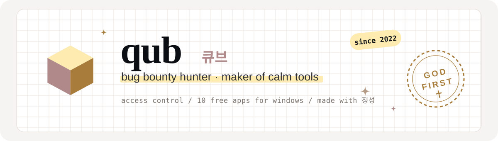

<picture>
  <source media="(prefers-color-scheme: dark)" srcset="assets/banner-dark.svg">
  
</picture>

  
  
  
  
  

### 안녕하세요, I'm qub ✦

I find the doors that should stay locked, and I build calm tools.

- **Bug bounty hunter** on [HackerOne](https://hackerone.com/qub) since 2022, focused on **broken access control**: the checks that decide who is allowed to see what.
- **Founder of [KellyBlue](https://kellyblue.site)**, a recon automation platform for authorized security testing.
- **Maker of free, open-source Windows apps** that feel soft, quiet and fast. No account, no tracking, everything stays on your PC.
- **God first.** I also create Christian content.
- Formerly **kellyblue**. Everywhere I operate now, I'm **qub**.

 

### ✦ Apps &nbsp;앱

Free for Windows 10 and 11. Every app has its own page with a one-click download. Two more are on the way.

<table>
<tr>
<td width="50%" valign="top">

<b>Coredit</b> 코레딧 
Code, text and Markdown editor on Monaco, with split panels and eight color profiles.
  

</td>
<td width="50%" valign="top">

<b><a href="https://qub-official.github.io/loom/">Loom</a></b> 룸 
A calm, fast terminal with tabs, split panes, snippets and saved workspaces.
  

</td>
</tr>
<tr>
<td width="50%" valign="top">

<b><a href="https://qub-official.github.io/moa/">Moa</a></b> 모아 
Videos, music and photos from YouTube, Instagram, TikTok, X and 1000+ sites.
  

</td>
<td width="50%" valign="top">

<b><a href="https://qub-official.github.io/youtown/">YouTown Player</a></b> 유타운 
Plays every format VLC plays, finds your whole library, and keeps a mini player on top.
  

</td>
</tr>
<tr>
<td width="50%" valign="top">

<b><a href="https://qub-official.github.io/jamgeum/">Jamgeum</a></b> 잠금 
An offline password manager. AES-256-GCM, generator, security check, auto-lock.
  

</td>
<td width="50%" valign="top">

<b><a href="https://qub-official.github.io/haneul-bible/">Haneul Bible</a></b> 하늘 
An offline learning Bible with people, places, maps, timelines and reading plans.
  

</td>
</tr>
<tr>
<td width="50%" valign="top">

<b><a href="https://qub-official.github.io/myrecord/">MyRecord</a></b> 마이레코드 
A drag-and-drop beat maker. Pick a style, apply it, then make it yours.
  

</td>
<td width="50%" valign="top">

<b><a href="https://qub-official.github.io/myproperties/">MyProperties</a></b> 내 PC 도우미 
Folder sizes, full PC specs, video to audio, live wallpapers and themes in one toolkit.
  

</td>
</tr>
<tr>
<td width="50%" valign="top">

<b><a href="https://qub-official.github.io/myTraffic/">myTraffic</a></b> 마이트래픽 
A local-first workbench for inspecting and replaying web traffic. Built for testers.
  

</td>
<td width="50%" valign="top">

<b>CopyCut Studio</b> 카피컷 
An offline video and image studio: timeline, keyframes, layers, masks, LUTs.
  

</td>
</tr>
</table>

 

### ✦ Security &nbsp;보안

**Disclosed at Vercel:** [Revoked deployment collaborator regains access to private comments](https://hackerone.com/reports/3852102) · Medium (4.8) · $1,026

Thanked by **Vercel**, **Toyota**, **X / xAI**, **Live Nation** and private programs (ranked **#2** on one). Also paid on Intigriti.

**[KellyBlue](https://kellyblue.site)** is my recon platform: scanners run in isolated containers, chain into workflows, enforce scope on every step, and can be driven by AI agents over MCP.

 

### ✦ Tools &nbsp;도구

 

  revoked access should stay revoked &nbsp;✦&nbsp; made with 정성 (care)

